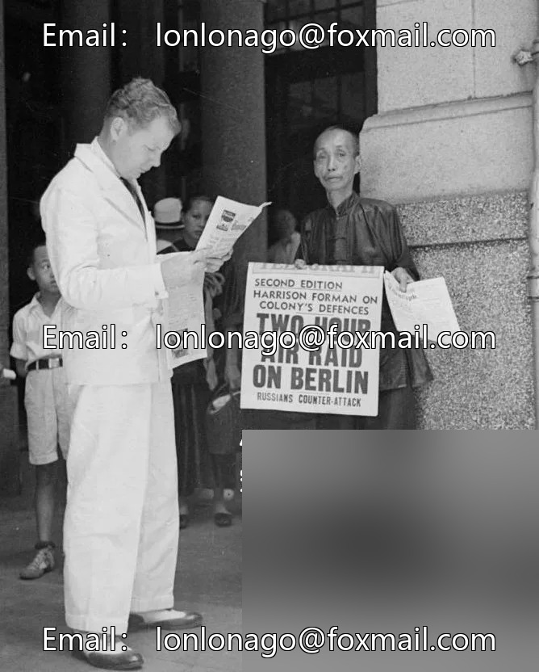
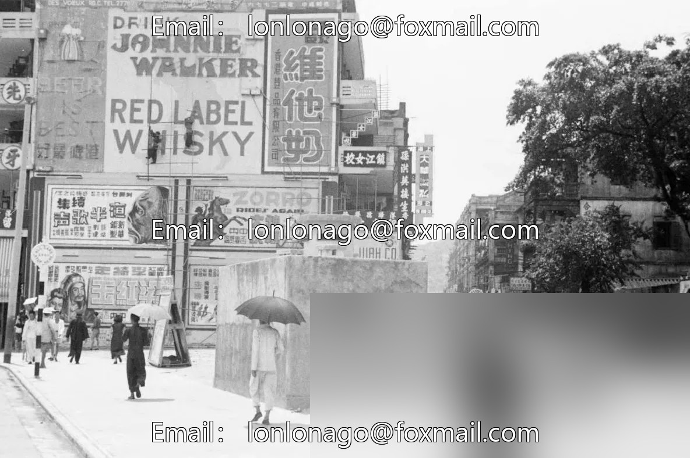
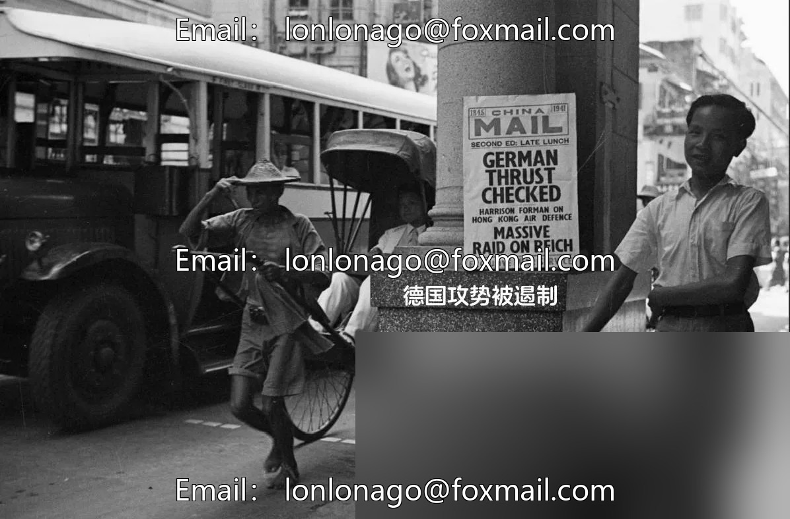
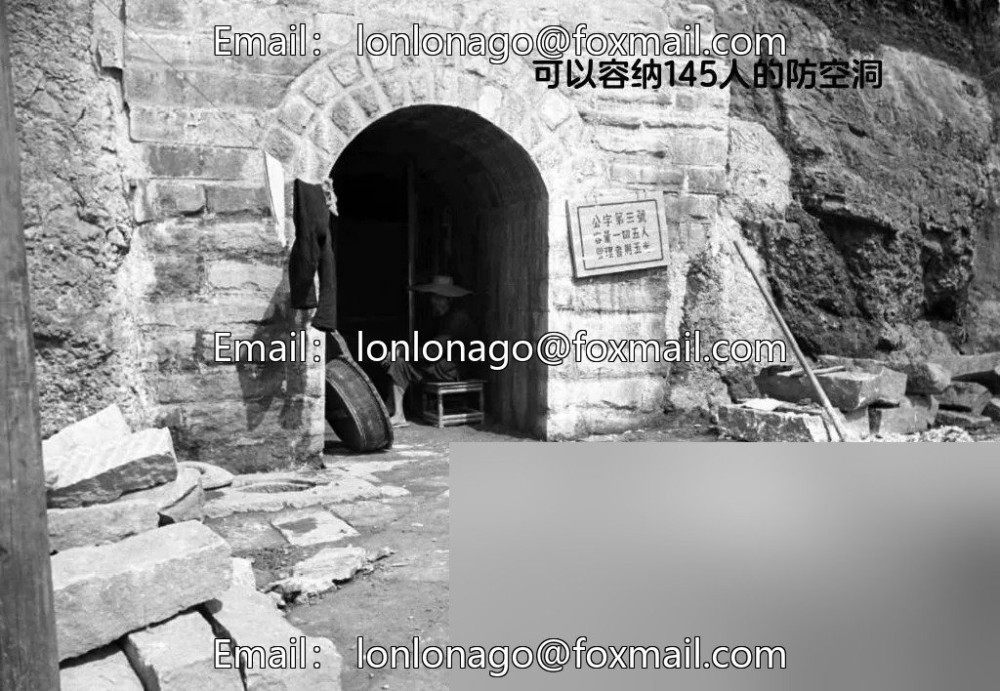
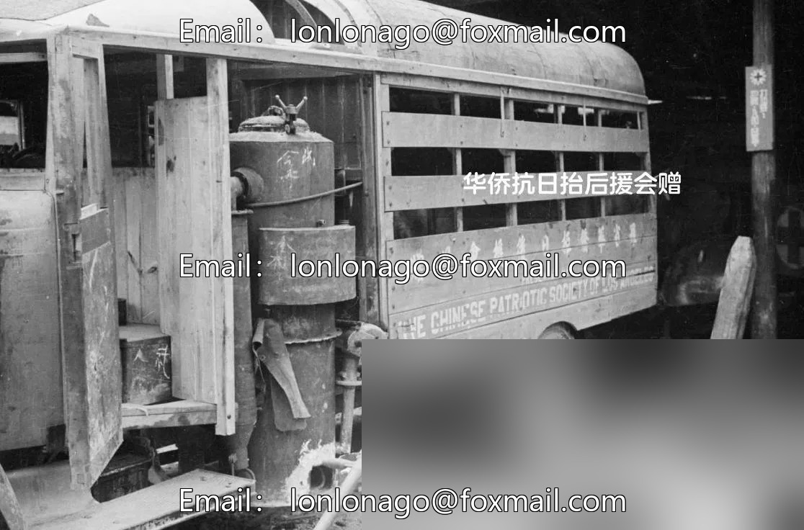
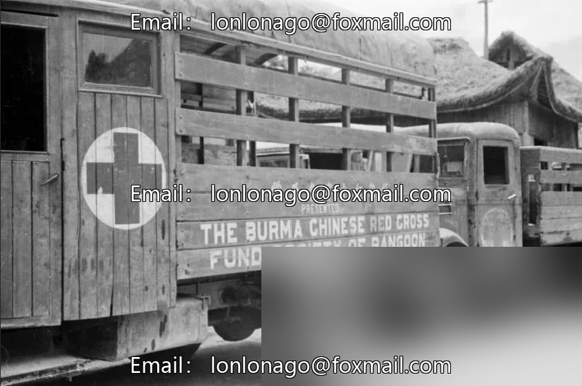
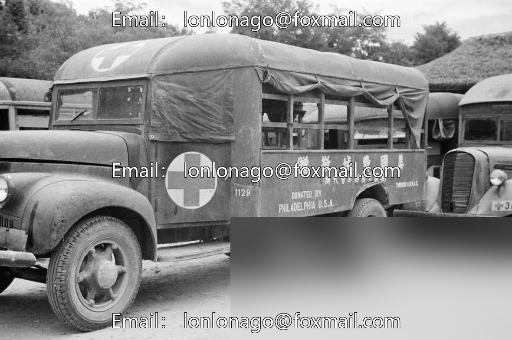
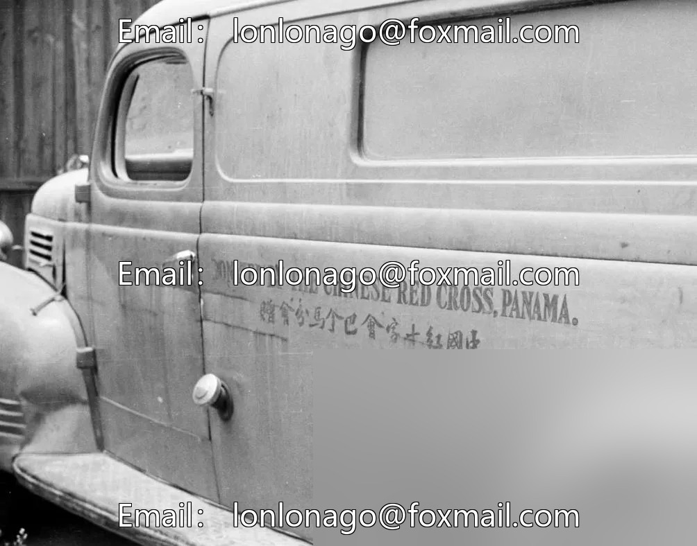

# Photographs from the Anti-Japanese War, rural and urban photography during World War II depicting civic customs and social conditions, recording 1932.

## Body

Old photos from the War of Resistance Period, photographing rural and urban scenes during World War II, illustrating customs and conditions, recording about 3,000 high-definition images from 1932 to 1944, totaling 6.8G.

Capable of profound significance, worthy of collection.
shared via web platform, can be purchased directly.

The material includes anti-Japanese era old photographs, WWII rural and urban photographic record of style and conditions, content from 1932 to 1944, approximately 3,000 high-definition images totaling 6.8 GB, with disk sharing and collection guidance available.

<!-- AI_ENRICHED -->

## Images

## Payment

Here is a pay link on Stripe ( https://buy.stripe.com/3cs8yP7sY87d0vu9AB ). Please contact me lonlonago@foxmail.com after funding $89, and I will send you a complete data files , thank you!

